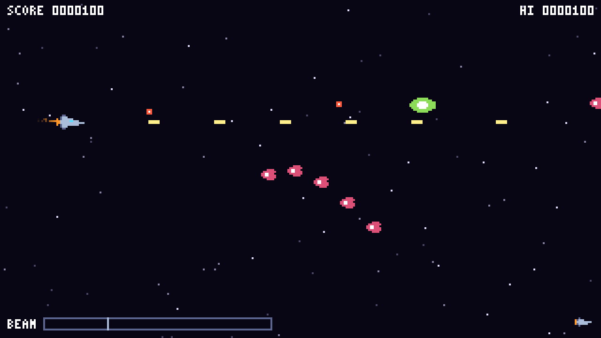

# Shmup



A horizontally scrolling shooter in the spirit of R-Type and Katakis, built with Godot 4.7 (.NET) and C#.
All game logic lives in C#. `Main.tscn` is the only scene; everything else is created at runtime.

## Setup (Omarchy / Arch)

```sh
sudo pacman -S godot-mono dotnet-sdk
cd shmup
dotnet build          # required before running from the terminal; the editor builds on its own
godot-mono -e         # open the editor, F5 runs the game
godot-mono --path .   # run the last build straight from the terminal
```

On Ubuntu, use the .NET build from godotengine.org together with `dotnet-sdk-8.0` (or newer).
Link its binary as `godot-mono` so the commands below work unchanged:

```sh
ln -s /path/to/Godot_v4.7.1-stable_mono_linux.x86_64 ~/.local/bin/godot-mono
```

## Controls

| Action | Keyboard | Gamepad |
|---|---|---|
| Move | Arrow keys / WASD | Stick / D-pad |
| Fire: tap = shot, hold = charge beam | Space / J | A |
| Pause | P | Start |
| Restart after game over | Enter | Start |
| Fullscreen | F11 | |
| Quit | Esc | |

The bindings are stored as an input map in `project.godot` and can be changed in the editor under
Project → Project Settings → Input Map.

## Structure

| File | Contents |
|---|---|
| `Scripts/Main.cs` | Game state, fixed 60 Hz tick, collisions, lives, score |
| `Scripts/Player.cs` | Movement, shot and beam charging, engine and charge particles |
| `Scripts/Enemies.cs` | `Enemy` base class plus `Drone`, `Chaser` and `Heavy` |
| `Scripts/Bullet.cs` | Shot, beam (piercing, hits each enemy once), aimed enemy shots |
| `Scripts/WaveSpawner.cs` | Random waves as a placeholder until real levels exist |
| `Scripts/Graphics.cs` | Palette, ASCII pixel sprites, explosions via `CpuParticles2D` |
| `Scripts/Starfield.cs`, `Scripts/Hud.cs` | Parallax stars, HUD with a 3×5 pixel font |

Technical notes:
- Internal resolution 320×180, integer scaling, nearest filtering, pixel snapping
- Renderer: GL Compatibility – sufficient for 2D and runs everywhere
- Game logic runs in `_PhysicsProcess` at a fixed 60 ticks so timing stays deterministic

## Building a release binary

Install the .NET export templates for 4.7.1 once, either via Editor → Manage Export Templates
or by extracting `templates/` from `Godot_v4.7.1-stable_mono_export_templates.tpz` (GitHub release)
into `~/.local/share/godot/export_templates/4.7.1.stable.mono/`. Then:

```sh
mkdir -p build/linux   # Godot does not create the export folder
godot-mono --headless --export-release "Linux" build/linux/shmup.x86_64
```

The output is `shmup.x86_64` plus the folder `data_Shmup_linuxbsd_x86_64`, which must stay next to it.
The export needs `Shmup.sln` to be present.

## Hyprland

Check the window class with `hyprctl clients` and add a window rule to make the game window float.
The exact syntax depends on your Hyprland version.

## Next steps

1. Force pod (attachable front/back, can be launched)
2. Level scene built in the editor: TileMapLayer for walls, Path2D for enemy formations
3. Sound effects via `AudioStreamPlayer`
